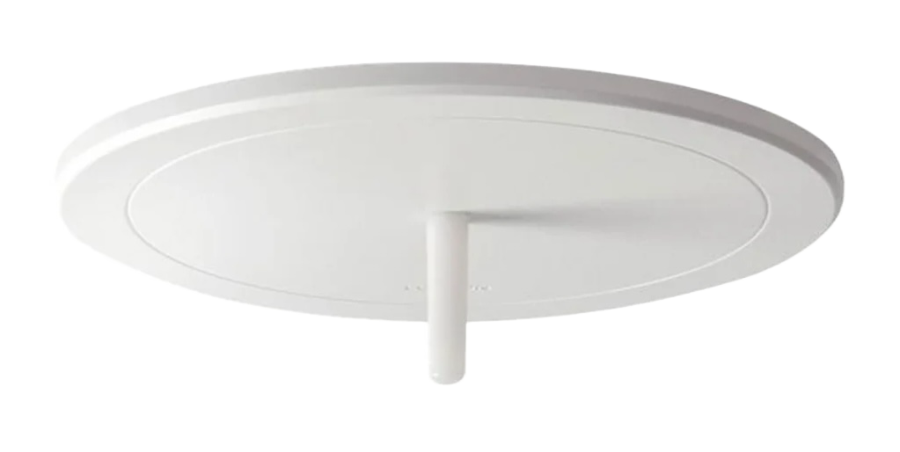

# lutron controller for flipper zero

a flipper zero app that drives the internal CC1101 to sniff, decode, learn from, and transmit Lutron Clear Connect Type A (CCA) packets at 433 MHz. you can control groups of lights - vive zones and picos - without the lutron app :)

the stock sub-ghz app can't actually read these signals (they're too fast for its raw mode), so this app talks to the radio chip directly instead.

_based on the reverse engineering in [lutron-protocols](https://github.com/alxgmpr/lutron-protocols), which is based on [Entropy512's lutron_hacks](https://github.com/Entropy512/lutron_hacks) and [Ceady's wireless interface writeup](https://hackaday.io/project/2291-integrated-room-sunrise-simulator/log/7223-the-wireless-interface)!_

## install

grab `lutron_controller.fap` from the [latest release](../../releases/latest) and copy it to `SD Card/apps/Sub-GHz/`. it shows up under apps → sub-ghz → lutron controller.

it's built for official flipper firmware - custom firmware will probably give "API mismatch", so build it yourself against that firmware instead.

## how to use

#### sniff / learn
shows every lutron packet nearby. press ok on a `VIVE` line (a hub command) or a `BTN` line (a pico press) and it asks which group to add that light to or if you want to a new one.

to catch a vive zone, leave sniff open near the hub until it sends something. _**if you're holding the flipper within a foot of the hub, -45-50 dB is typical for the signal strength. around 5 feet underneath will have a signal strength of ~-55 dB**_ signal strengths of -80 or -90 dB are likely significantly further away!

vive hubs look like this when installed in a ceiling:



#### control (groups)
make a group, name it, and add lights. a light is either a vive zone (hub id + zone) or a pico. pick a group to run on, off, level, raise, and lower commands for everything in the group at once. _(picos get skipped for level commands since they don't have a level button. raise/lower commands are also very granular, so they might be extremely slow to change!)_

#### settings
radio channel (starts on 26 every time you open the app), how many times each packet repeats, logging to the sd card, and whether sniff shows corrupted packets.

#### setup flow

if you have lights connected to a lutron vive hub:
1. go to one of your hubs and hold your flipper near it in sniff / learn mode until you see a `VIVE` command appear
2. _**if the signal strength** (which you can find by hitting the right arrow while hovering over the command and looking at the top right) **seems reasonable relative to the distance you were holding it from the hub**_ (see the sniff / learn section), click the command and add it to a group
3. repeat until you have added all the hubs you want to control to your group
4. use the control menu to control your lights!

## building the app

you need [ufbt](https://github.com/flipperdevices/flipperzero-ufbt) (`pip install ufbt`):

```sh
ufbt          # builds dist/lutron_controller.fap
ufbt launch   # installs it on a plugged-in flipper and opens it
```

the packet encoder/decoder has tests that run on your computer:

```sh
cc -std=c11 -Wall -Wextra -I. -o test/codec_test test/codec_test.c cca_codec.c && ./test/codec_test
```